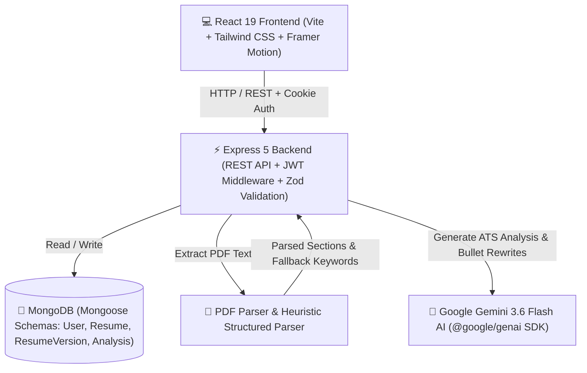

<div align="center">

  # ✨ AI Resume Analyzer & Optimizer

  <p align="center">
    <b>A modern, glossy full-stack MERN application powered by Google Gemini 3.6 Flash AI</b><br />
    <i>Automated ATS Scoring · Bullet Rewrites · Version Diffing · Keyword Insights · Glassmorphism UI</i>
  </p>

  <p align="center">
    
    
    
    
    
    
    
  </p>

  ---
</div>

## 🌟 Overview

**AI Resume Analyzer** is an enterprise-grade web application designed to help job seekers optimize their resumes for ATS (Applicant Tracking Systems) and recruiter standards. Built with a **glossy glassmorphism design system**, dynamic animations, and **Google Gemini 3.6 Flash AI**, it provides real-time scoring, actionable feedback, keyword matching, version control, and side-by-side diff tracking.

---

## ⚡ Core Features

- 📄 **PDF Text Extraction & Section Parsing**: Upload PDF resumes with automatic parsing into structured sections (Basics, Summary, Experience, Education, Technical Skills, Projects, Certifications) backed by deterministic fallback heuristics.
- 🎯 **AI-Powered ATS Scoring**: Get 0–100 overall ATS scores broken down across 4 dimensions:
  - 🔑 **Keywords Match** (0–25)
  - 📐 **Formatting & Structure** (0–25)
  - 📈 **Quantified Impact** (0–25)
  - ✍️ **Clarity & Tone** (0–25)
- 💡 **Actionable Diagnostics & Strengths**: 5 prioritized issues with severity tags and specific fix instructions, plus 5 key resume strengths backed by direct quotes.
- 🔄 **One-Click Bullet Rewrites**: Transform weak bullet points into high-impact, ATS-optimized achievements tailored to target job roles.
- 🌿 **Version Control & Iteration Tracking**: Auto-generates new versions (`V1` → `V2` → `V3`) when rewrites are applied, storing complete historical snapshots.
- 🔀 **Interactive Version Diff Viewer**: Compare character-level and line-level changes between any two resume versions with visual indicators for additions and deletions.
- 📊 **Glossy Analytics & Insights**: Interactive dashboard displaying score evolution sparklines, keyword frequencies, issue resolution rates, and recent activity logs.
- 🔒 **Secure Authentication**: Cookie-based JWT authentication with BCrypt password hashing and Zod schema validation.

---

## 🏗️ System Architecture



---

## 🎨 Design System & Aesthetics

Designed with modern UI/UX principles to deliver a premium user experience:

- **Glassmorphism & Glossy Accents**: Translucent dark/light surfaces with subtle border glows and dynamic background gradients.
- **Fluid Micro-Animations**: Built with **Framer Motion** for smooth tabs transitions, expandable accordion cards, and animated score meters.
- **Data Visualizations**: Responsive charts powered by **Recharts** for ATS score trends, keyword distributions, and version progression.

---

## 📁 Repository Structure

```
ai-resume-analyzer/
├── backend/
│   ├── src/
│   │   ├── config/          # Environment variables & DB connection
│   │   ├── middleware/      # Auth, rate-limiting, file upload & validation
│   │   ├── models/          # Mongoose models (User, Resume, ResumeVersion, Analysis)
│   │   ├── routes/          # REST endpoints (auth, resumes, dashboard, insights, history, versions)
│   │   ├── services/        # Gemini AI, PDF parser, structured parser, diff service
│   │   ├── utils/           # JWT, ApiError & async handler utilities
│   │   └── server.js        # Express app entry point
│   ├── .env.example         # Backend environment variables template
│   └── package.json
│
├── frontend/
│   ├── src/
│   │   ├── api/             # Axios API client & endpoint hooks
│   │   ├── components/      # UI components (layout, analysis, diff, export, cards)
│   │   ├── hooks/           # TanStack React Query hooks
│   │   ├── pages/           # Application views (Dashboard, ResumeDetail, Insights, History, Versions)
│   │   └── main.jsx         # React application entry point
│   ├── vite.config.js       # Vite build & backend proxy configuration
│   └── package.json
│
├── .gitignore               # Clean MERN stack gitignore
└── README.md
```

---

## 🚀 Getting Started

### Prerequisites

- **Node.js**: `v20.0.0` or higher
- **npm** or **yarn**
- **MongoDB**: A running MongoDB instance or MongoDB Atlas cluster URI
- **Google Gemini API Key**: Obtainable from [Google AI Studio](https://aistudio.google.com/)

---

### 1️⃣ Backend Setup

```bash
# Navigate to backend directory
cd backend

# Install dependencies
npm install

# Create environment configuration file
cp .env.example .env
```

Edit `backend/.env` with your credentials:

```env
NODE_ENV=development
PORT=5000

MONGO_URI=mongodb+srv://<username>:<password>@cluster.mongodb.net/ai_resume
JWT_SECRET=your_super_secret_jwt_key
JWT_EXPIRES_IN=7d
COOKIE_NAME=token

CLIENT_ORIGIN=http://localhost:5173

GEMINI_API_KEY=your_google_gemini_api_key
GEMINI_MODEL=gemini-3.6-flash
```

Start the backend development server:

```bash
npm run dev
# Backend server runs on http://localhost:5000
```

---

### 2️⃣ Frontend Setup

```bash
# Navigate to frontend directory
cd ../frontend

# Install dependencies
npm install

# Start Vite development server
npm run dev
# Frontend app runs on http://localhost:5173
```

---

## 🛠️ API Reference

### 🔐 Authentication (`/api/auth`)

| Method | Endpoint | Description |
| :--- | :--- | :--- |
| `POST` | `/api/auth/register` | Register a new user account |
| `POST` | `/api/auth/login` | Authenticate user & issue session cookie |
| `POST` | `/api/auth/logout` | Clear authentication cookie |
| `GET`  | `/api/auth/me` | Fetch active user session details |

### 📄 Resumes & AI Operations (`/api/resumes`)

| Method | Endpoint | Description |
| :--- | :--- | :--- |
| `POST` | `/api/resumes` | Upload PDF resume, extract text & parse structured sections |
| `GET`  | `/api/resumes` | Retrieve all resumes owned by the authenticated user |
| `GET`  | `/api/resumes/:id` | Fetch resume details & version stack |
| `POST` | `/api/resumes/:id/analyze` | Run Gemini AI ATS scoring, issue diagnosis & keyword extraction |
| `POST` | `/api/resumes/:id/rewrite` | Apply selected bullet rewrites and auto-create version `V2+` |
| `GET`  | `/api/resumes/:id/diff` | Compute character & line diffs between two versions (`?from=v1&to=v2`) |

### 📊 Analytics & Reporting

| Method | Endpoint | Description |
| :--- | :--- | :--- |
| `GET`  | `/api/dashboard` | Returns totals, KPI metrics, score series, and recent activity |
| `GET`  | `/api/insights` | Aggregate analytics (score trends, keyword frequencies, top issues) |
| `GET`  | `/api/history` | Chronological activity event feed |
| `GET`  | `/api/versions` | List all historical versions across resumes |

---

## 🧪 License & Attribution

Distributed under the **MIT License**. See `LICENSE` for more information.

<div align="center">
  <sub>Built with ❤️ using React 19, Express, MongoDB, and Google Gemini AI</sub>
</div>